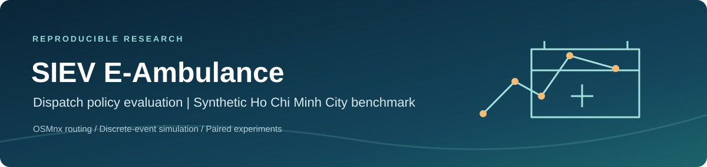
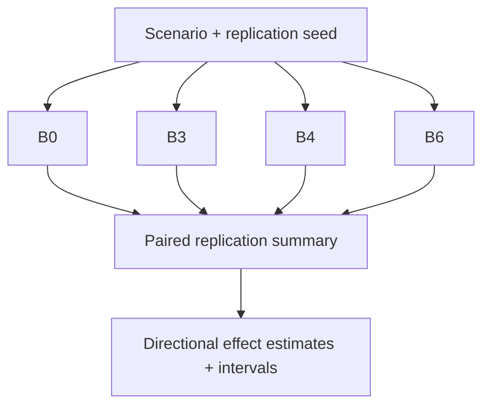

<p align="center"></p>

<h1 align="center">SIEV E-Ambulance Research</h1>
<p align="center"><strong>Reproducible evaluation of electric-ambulance dispatch policies</strong></p>
<p align="center">
  
  
  
</p>
<p align="center">
  <a href="#research-workflow">Workflow</a> · <a href="#current-status">Evidence</a> · <a href="#requirements-and-setup">Setup</a> · <a href="#scientific-limitations">Limitations</a> · <a href="#research-documentation">Documents</a>
</p>

## Research at a glance

| | Research layer | Purpose |
| :--: | --- | --- |
|  | **Network & feasibility** | Curated points, OSMnx paths and EV operational constraints |
|  | **Policy simulation** | B0/B3/B4/B6 on rolling discrete-event simulation |
|  | **Reproducibility** | Paired replications, invariant checks and statistical summaries |

## Research workflow




> [!IMPORTANT]
> **Research boundaries:** The incident/fleet data and receiving-capacity assumptions are synthetic; hospital names and geographic anchors are not evidence of real-time clinical capacity. OSMnx travel times are an uncalibrated free-flow baseline. Results are simulation findings, not validated emergency medical dispatch guidance. The paired replication is the statistical unit, not the individual incident.

---

## Technical report and reproduction

Reproducible research pipeline for evaluating electric-ambulance dispatch policies on a synthetic Ho Chi Minh City benchmark. The repository combines synthetic data generation and validation, OSMnx routing, rolling discrete-event simulation (DES), paired policy evaluation, and report exports.

> **Evidence boundary:** the dataset, hospital receiving capacity, fleet operations, and several runtime parameters are synthetic assumptions. OSMnx travel times are a free-flow routing baseline until locally calibrated. Haversine runs are engineering smoke tests only.

## Current status

| Component | Status |
| --- | --- |
| Synthetic dataset QA | 16/16 checks passed |
| Rolling DES | Implemented |
| Policies | B0, B3, B4, and B6 implemented |
| Versioned smoke tests | 1-rep and 3-rep outputs available; runtime validation 7/7 passed |
| OSMnx routing | Builder implemented; local artifacts generated and integration-tested |
| 30-paired experiment | Completed locally: 360/360 policy runs, 0 failures |
| Pairing audit | 90/90 scenario-replication groups complete |

The generated OSMnx network and full `experiments/paired_30/` results are intentionally Git-ignored because of their size. The tracked repository contains source code, synthetic inputs, validation summaries, provenance records, and compact smoke-test fixtures needed to inspect the pipeline.

## Dispatch policies

| Policy | Role | Main feasibility rules |
| --- | --- | --- |
| `B0` | Naive nearest-dispatch reference | Availability, route reachability, emergency receiving, and physical energy to hospital |
| `B3` | Hospital-aware baseline | B0 conditions plus specialty/capability and modeled capacity |
| `B4` | Deterministic EV-feasibility baseline | B3 conditions plus deterministic SOC reserve through the nearest charger |
| `B6` | Integrated uncertainty-aware policy | Capability, capacity, buffered SOC feasibility, and an epsilon-constraint MILP operating point |

`B0` deliberately does not enforce the same hard-feasibility set as B3/B4/B6. For the marginal value of integration, `B6-B3` and `B6-B4` are therefore more informative comparisons than `B6-B0`.

## Repository layout

```text
configs/          Runtime and experiment configuration
data/             Synthetic inputs, schema documentation, and local OSMnx artifacts
eda_pre_osmnx/    Pre-OSMnx EDA and routing-point exports
experiments/      Versioned smoke fixtures and Git-ignored full/local runs
notebooks/        Workflow notebooks 01-09
plots/            Compact research figures
provenance/       File inventories, hashes, and final-pipeline lock
report_exports/   Tables and publication figures generated by Notebook 09
results/          Small derived research results
scripts/          Reproducible command-line entry points
src/              Dataset, routing, simulation, policy, validation, and analysis code
validation/       Dataset QA and audit summaries
archive/          Local legacy/reference material; excluded from Git
```

## Requirements and setup

The validated runtime is Python 3.13.15. `requirements.txt` installs the main experiment stack; the purpose-specific requirement files support narrower environments, including optional Parquet export.

```bash
./scripts/bootstrap.sh
source .venv/bin/activate
```

To use another Python 3.13 executable during setup:

```bash
PROJECT_PYTHON=/path/to/python3.13 ./scripts/bootstrap.sh
```

## Quick verification

Run the tracked validation suite after activating the environment:

```bash
./scripts/check.sh
```

This command compiles the Python sources, validates the synthetic dataset, and re-validates the tracked 1-rep and 3-rep smoke outputs.

For a fresh one-rep engineering run using the explicitly labeled Haversine fallback:

```bash
./scripts/run_smoke.sh
.venv/bin/python src/validate_runtime_outputs.py \
  --experiment experiments/smoke_1rep
```

Do not report numerical results from Haversine smoke runs as scientific findings.

## Reproduce the OSMnx experiment

### 1. Inspect inputs and EDA

Start with `notebooks/01_EDA_Pre_OSMnx.ipynb`. Its routing inputs are written to `eda_pre_osmnx/osmnx_points.csv` and `eda_pre_osmnx/osmnx_bbox.json`.

### 2. Build routing artifacts

```bash
.venv/bin/python src/build_osmnx_network.py --precheck
.venv/bin/python src/build_osmnx_network.py
```

The builder writes the following Git-ignored files under `data/osmnx/`:

```text
study_graph.graphml
point_node_map.csv
snap_qa.csv
incident_hospital_od.csv.gz
hospital_charger_od.csv
network_metadata.json
```

The graph contains OSMnx-imputed free-flow edge speeds and travel times. Review `snap_qa.csv` and `network_metadata.json` before using the network in an experiment. Notebook 02 is an interactive wrapper around the same build step.

### 3. Run the paired experiment

```bash
./scripts/run_30_paired_osmnx.sh
```

The script:

1. verifies `provenance/final_pipeline_lock.json` against the runtime, dependencies, code, inputs, and routing artifacts;
2. runs 3 scenarios x 30 paired replications x 4 policies = 360 policy runs;
3. validates runtime invariants; and
4. generates paired comparison summaries.

The default worker count is 4. Override it when needed:

```bash
PAIRED_WORKERS=8 ./scripts/run_30_paired_osmnx.sh
```

Each `(scenario_id, replication_id)` uses the same random seed and common-random group across B0/B3/B4/B6. The statistical unit is the paired replication, not each incident.

## Experiment outputs

Each policy run writes:

```text
experiments/paired_30/runs/<scenario>/<replication>/<policy>/
|-- dispatch_decisions.csv.gz
|-- des_event_log.csv.gz
|-- mission_metrics.csv.gz
|-- constraint_violations.csv
`-- replication_metrics.json
```

Aggregate outputs are written to:

```text
experiments/paired_30/
|-- run_manifest.csv
|-- replication_metrics.csv
|-- run_failures.csv
|-- run_summary.json
|-- runtime_validation.json
`-- analysis/
    |-- pairing_audit.csv
    |-- pairing_completeness.json
    `-- paired_comparison_summary.csv
```

`src/analyze_paired.py` reports the mean and median oriented improvement, bootstrap 95% confidence interval, and paired effect size for B6 versus B0/B3/B4. Positive oriented values mean B6 performed better. The analyzer does not currently produce hypothesis-test p-values.

## Notebook workflow

| Notebook | Purpose |
| --- | --- |
| 01 | Pre-OSMnx EDA and geographic QA |
| 02 | OSMnx network build wrapper and precheck |
| 03 | Traffic calibration and time-dependent routing scaffold |
| 04 | Energy and candidate-feasibility analysis |
| 05 | Rolling DES baselines |
| 06 | B6 epsilon-constraint MILP |
| 07 | 30 paired replications |
| 08 | Runtime-engine verification |
| 09 | Report tables and publication figures |

Notebook 09 prefers `experiments/paired_30/replication_metrics.csv`. If that file is unavailable, it falls back to the tracked 3-rep smoke results and labels exports as `engineering_preview`.

## Scientific limitations

- Hospital capacity is modeled synthetic receiving capacity, not observed bed availability.
- OSMnx speeds and travel times are a free-flow baseline until calibrated with local traffic evidence.
- Haversine fallback is only for software smoke testing.
- Charging thresholds, handover time, occupancy hold time, and the energy uncertainty buffer are explicit simulation assumptions requiring calibration or sensitivity analysis.
- B6 uses one pre-specified epsilon operating rule; it is not a full Pareto-frontier sweep.
- B0/B3/B4/B6 are a policy ladder, not a controlled one-factor-at-a-time ablation.

## Research documentation

- [`RUNBOOK_TO_30_PAIRED.md`](RUNBOOK_TO_30_PAIRED.md) — detailed operating protocol and invariant definitions.
- [`EXPERIMENT_ROADMAP_TO_30_PAIRED.md`](EXPERIMENT_ROADMAP_TO_30_PAIRED.md) — stage-by-stage research roadmap.
- [`MANUSCRIPT_SECTIONS_2_6_2_7.md`](MANUSCRIPT_SECTIONS_2_6_2_7.md) — canonical manuscript text for the policy and experiment design.
- [`data/data_dictionary.csv`](data/data_dictionary.csv) — dataset field definitions.
- [`data/parameter_registry.csv`](data/parameter_registry.csv) — parameter provenance and assumptions.
